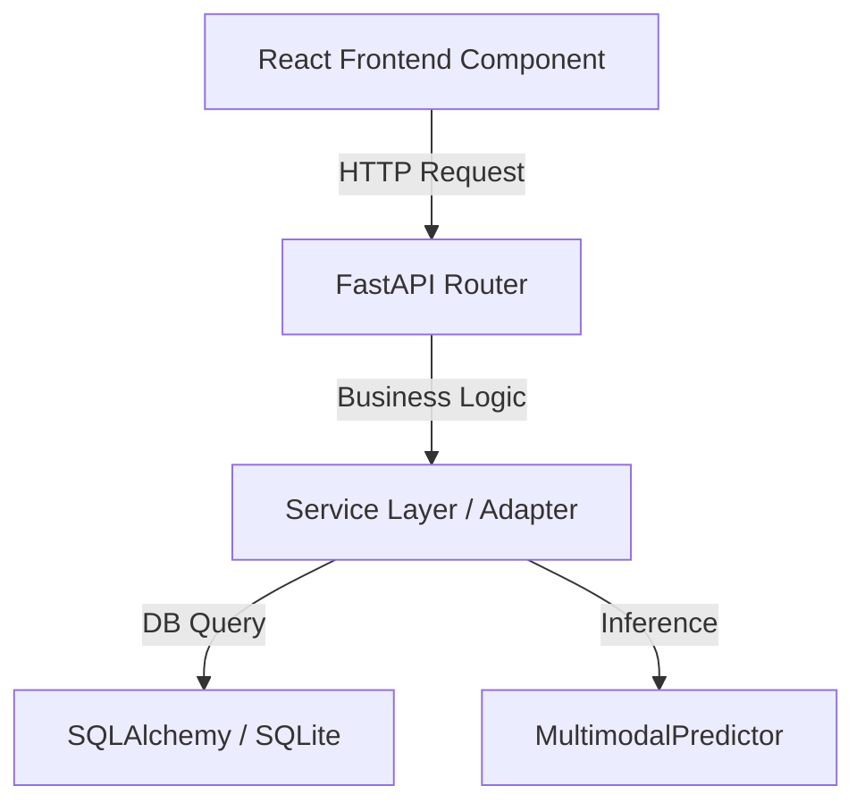

# Hackathon Challenge Extension Guide

This guide outlines how to quickly implement extension points during the hackathon challenges.

---

## 1. Core Extension Framework

---

## 2. Likely Extension Scenarios & Implementation Blueprints

### Scenario A: Weather or Government API Integration
- **Goal**: Fetch real-time weather warnings or satellite alerts for incident locations.
- **Backend Files to Change**:
  - `backend/app/services/weather_service.py` (New service calling external REST endpoints)
  - `backend/app/routers/incidents.py` (Include weather context during incident retrieval)
- **Frontend Files to Change**:
  - `frontend/src/components/Dashboard.jsx` (Display warning badges near incident details)
- **Reusable Services**: `backend/app/db/session.py` for logging external alerts.
- **Complexity**: Low (Estimated 30 mins)
- **Potential Risks**: External API latency or rate limiting. Always implement cached fallback.

### Scenario B: SMS / WhatsApp Alerts
- **Goal**: Notify responders or citizens when an incident changes state (e.g. Triage level critical).
- **Backend Files to Change**:
  - `backend/app/services/notification_service.py` (New client interface using Twilio API)
  - `backend/app/routers/incidents.py` (Trigger notification on POST `/incidents` or PUT `/incidents/{id}`)
- **Frontend Files to Change**: None (silent background notification)
- **Reusable Services**: Authentication helper for secure token configuration.
- **Complexity**: Low-Medium (Estimated 45 mins)
- **Potential Risks**: Blocked webhook delivery or invalid phone formatting.

### Scenario C: Voice Input for Citizen Reports
- **Goal**: Allow users to dictate emergency reports instead of typing.
- **Backend Files to Change**:
  - `backend/app/routers/predict.py` (Extend router to accept audio uploads and transcribe via Whisper API)
- **Frontend Files to Change**:
  - `frontend/src/components/ReportModal.jsx` (Add microphone button and speech-recording states)
- **Reusable Services**: `ml_service.py` for predicting priority scores from transcribed text.
- **Complexity**: Medium (Estimated 60 mins)
- **Potential Risks**: Background noise causing poor translation quality. Maintain manual text edit fallback.

### Scenario D: Resource Allocation & Route Optimization
- **Goal**: Map and dispatch responders based on coordinates and priority score.
- **Backend Files to Change**:
  - `backend/app/routers/responder.py` (Calculate distance matrix via Haversine formula)
- **Frontend Files to Change**:
  - `frontend/src/components/Dashboard.jsx` (Add routing path overlays using Leaflet Map component)
- **Reusable Services**: Incident schema and database models.
- **Complexity**: Medium-High (Estimated 90 mins)
- **Potential Risks**: Leaflet tile loading lag or rendering performance.

### Scenario E: WebSockets for Real-Time Updates
- **Goal**: Broadcast new incidents instantly to all active responder dashboards.
- **Backend Files to Change**:
  - `backend/app/main.py` (Initialize a FastAPI WebSocket connection manager)
  - `backend/app/routers/incidents.py` (Broadcast on creation)
- **Frontend Files to Change**:
  - `frontend/src/components/Dashboard.jsx` (Maintain a persistent socket connection)
- **Reusable Services**: Database models.
- **Complexity**: Medium (Estimated 60 mins)
- **Potential Risks**: Connection drop management. Fallback to long-polling every 10 seconds.

---

## 3. Recommended Tech Stack for Quick Integrations
- **HTTP Client**: `httpx` (Asynchronous operations in python)
- **Mapping**: `react-leaflet` (Leaflet.js wrappers for quick map markers)
- **Icon Assets**: `lucide-react` (Pre-installed premium dashboard icon pack)
