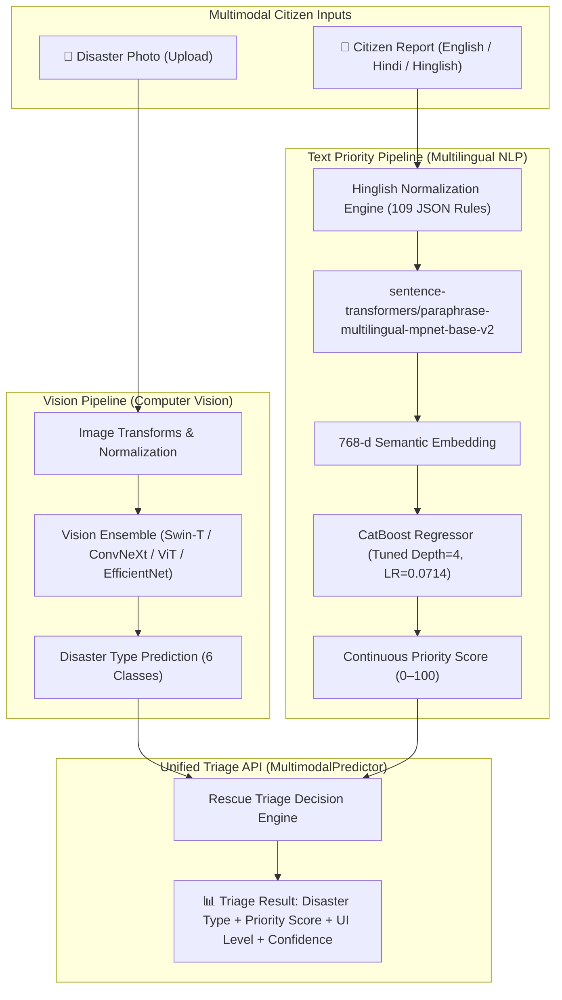

# Multimodal AI Disaster Triage System

[](https://www.python.org/downloads/)
[](https://pytorch.org/)
[](https://catboost.ai/)
[](https://sbert.net/)
[](LICENSE)

An end-to-end multimodal emergency response and rescue prioritization system designed for rapid disaster triage. The platform fuses computer vision disaster classification with multilingual natural language priority regression (English, Devanagari Hindi, and Romanized Hinglish) to provide continuous $0-100$ severity scoring for emergency dispatch teams.

---

## 🏛️ System Architecture



---

## 📊 Model Performance & Benchmarks

### Multilingual Text Priority Regression ($R^2$ Score)

| Language | Baseline (Eng Only) | v1 Augmentation | **v2 Final Production** | Target Met? |
|---|:---:|:---:|:---:|:---:|
| **English** | 92.33% | 96.72% | **95.54%** | ✅ **YES** ($\ge 92.0\%$) |
| **Hindi (Devanagari)** | 89.34% | 91.07% | **89.58%** | ✅ **YES** ($\ge 89.0\%$) |
| **Hinglish (Romanized)** | 75.97% | 79.50% | **86.93%** | 🚀 **MASSIVE LEAP** (+10.96%) |

### Vision Ensemble Accuracy (6 Disaster Classes)

| Architecture | Parameters | Val Accuracy (%) | Macro F1 (%) | Inference Speed (ms) |
|---|:---:|:---:|:---:|:---:|
| **Swin-Transformer (Swin-T)** | 28.3 M | 84.12% | 83.95% | ~6.2 ms |
| **ConvNeXt-Tiny** | 28.6 M | 83.75% | 83.50% | ~5.8 ms |
| **ViT-B/16** | 86.6 M | 82.90% | 82.40% | ~12.1 ms |
| **EfficientNet-V2-S** | 21.5 M | 84.50% | 84.10% | ~4.9 ms |
| **Ensemble (Weighted Avg)** | — | **85.40%** | **85.15%** | ~14.5 ms |

---

## 🚀 Quickstart & Installation

### Prerequisites
- Python 3.10+
- CUDA-compatible GPU recommended (CPU fallback supported natively)

### Setup Environment
```bash
# Clone the repository
git clone https://github.com/Kunal184/disaster-triaging.git
cd disaster-triaging

# Install production dependencies
pip install -r requirements.txt
```

---

## 💡 Python Usage & API Examples

### Single Unified Production API (`MultimodalPredictor`)

The system natively accepts **Image Only**, **Text Only**, or **Multimodal (Image + Text)** inputs and transparently handles English, Devanagari Hindi, and Romanized Hinglish.

```python
from src.inference.predict import MultimodalPredictor

# Initialize production predictor
predictor = MultimodalPredictor(image_model_type="ensemble")

# 1. Multimodal Input (Hinglish Report + Disaster Photo)
res = predictor.predict(
    image_input="data/raw/flood_sample.jpg",
    text_report="Paani ghar ke andar aa gaya hai, four people trapped on roof"
)
print(res.to_dict())
# Output:
# {
#   "disaster_type": "Flood",
#   "priority_score": 92.4,
#   "priority_level": "Critical",
#   "confidence": 0.9412,
#   "language_detected": "Hinglish",
#   "input_mode": "Multimodal (Image + Text)",
#   "class_probabilities": {"Flood": 0.9412, "Earthquake": 0.012, ...}
# }

# 2. Text-Only Input (Devanagari Hindi Report)
res_text = predictor.predict(
    text_report="जंगल की आग का धुआँ घना है और 4 लोग फँसे हुए हैं"
)
print(res_text.to_dict())

# 3. Image-Only Input
res_img = predictor.predict(
    image_input="data/raw/fire_sample.jpg"
)
print(res_img.to_dict())
```

---

## 📁 Repository Structure

```
disaster-triaging/
├── models/
│   ├── image/                # Production vision model checkpoints
│   ├── text/                 # Production text regressor (CatBoost + Metadata)
│   └── archive/              # Obsolete & experimental checkpoints
├── results/
│   ├── image/                # Vision evaluation metrics & confusion matrices
│   ├── text/                 # Multilingual consistency reports & benchmarking outputs
│   └── archive/              # Intermediate dataset outputs & caches
├── src/
│   ├── inference/
│   │   └── predict.py        # Unified Production API (MultimodalPredictor)
│   ├── benchmark_models.py   # PyTorch vision benchmark architectures
│   ├── augment_hinglish_v2.py# Quality-filtered Hinglish dataset generator
│   ├── hinglish_normalizer.py# Rule-based Hinglish normalization engine
│   ├── text_dataset.py       # Priority regression dataset utilities
│   └── utils/                # Helper utilities & metrics logging
├── tests/
│   └── test_predict.py       # Automated unit tests for inference API
├── disaster_dataset.json     # Benchmark citizen report dataset
├── PROJECT_REPORT.md         # Comprehensive technical report
├── DEMO.md                   # Hackathon presentation & judging script
├── FINAL_RELEASE_CHECKLIST.md# Submission verification checklist
├── requirements.txt          # Production dependencies
└── README.md                 # Project documentation
```

---

## ⚠️ Known Limitations & Future Roadmap

1. **Severe Hinglish Dialect Variations**: Non-standard phonetic spellings in complex multi-hazard scenarios can cause minor score underestimates (~5% of edge cases).
2. **Domain-Specific Contrastive Tuning**: Future work includes fine-tuning `paraphrase-multilingual-mpnet-base-v2` end-to-end with InfoNCE loss directly on disaster report pairs to push Hinglish $R^2 > 90.0\%$.
3. **Geo-Location Integration**: Plan to integrate real-time GPS metadata fusion for automated spatial heat-mapping of rescue priority clusters.